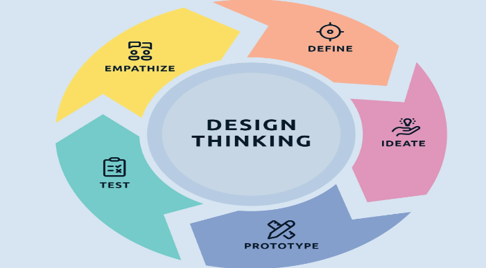
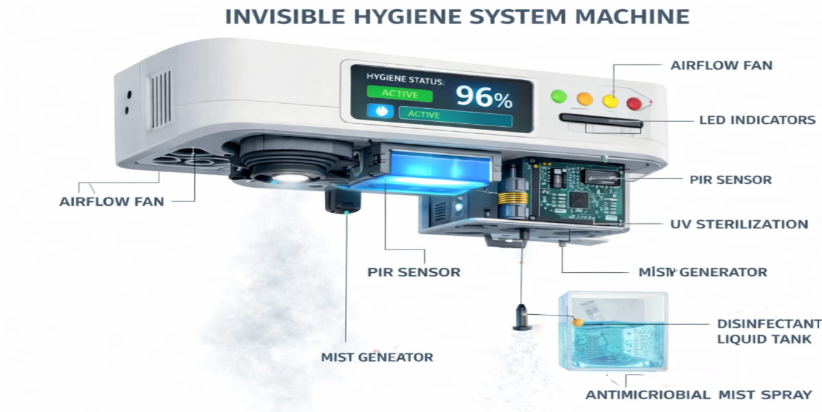
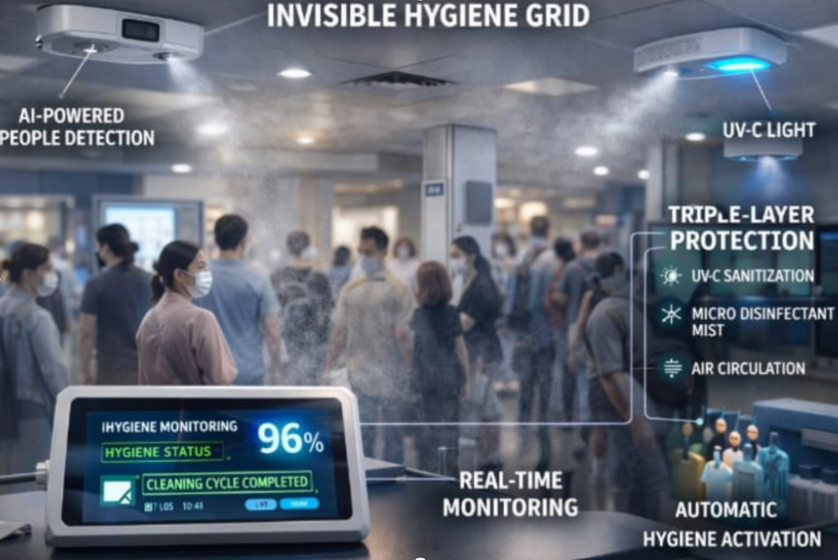
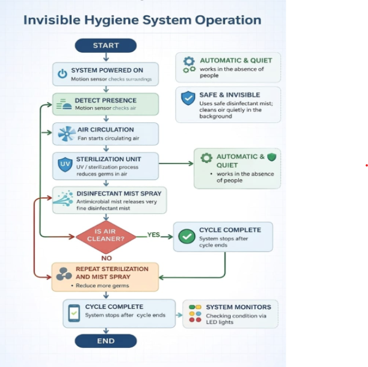

# Smart Hygiene Grid

> A Design Thinking & Innovation project proposing an automated hygiene solution for safer public spaces.

---

## Project Overview

Smart Hygiene Grid is a conceptual public hygiene system designed to improve cleanliness and reduce the spread of germs in crowded environments. The proposed solution combines automated air purification, UV-C sterilization, sensor-based activation, and disinfectant mist spraying to create a safer and healthier environment with minimal human intervention.

This project was developed as part of the **Design Thinking & Innovation (DTI)** course and focuses on solving a real-world public health challenge through a structured design thinking approach.

---

## Problem Statement

Public places such as hospitals, schools, shopping malls, and transport stations rely heavily on periodic manual cleaning. This creates long intervals during which germs and airborne contaminants can continue to spread.

The Smart Hygiene Grid proposes an automated system that continuously helps maintain hygiene while operating safely and efficiently in the background.

---

## Proposed Solution

The proposed system integrates multiple hygiene technologies into a single automated solution:

- Air purification
- UV-C sterilization
- Sensor-based automatic activation
- Controlled disinfectant mist spraying
- LED status indication for monitoring

The system is designed to improve hygiene without interrupting normal public activities.

---

## Key Features

- Automated hygiene management
- Continuous air purification
- UV-C sterilization
- Sensor-based operation
- Energy-efficient design concept
- Suitable for large public environments
- Scalable for future smart city integration

---

## Applications

- Hospitals
- Schools and Colleges
- Shopping Malls
- Railway Stations
- Bus Stations
- Airports
- Government Buildings

---

---

## 📸 Project Visuals



---

### Image Prototype



---

### Real World Usage



---

### Workflow



---

---
## Project Documentation

The complete project documentation is available in the **docs** folder.

```
docs/Invisible_Hygiene_System_Project_Report.pdf
```
---

---

## Future Scope

- AI-based monitoring
- IoT integration
- Smart city deployment
- Predictive maintenance
- Large-scale public infrastructure implementation

---

## Authors

- Bhashitha Chennu

---

> **Note:** This repository presents the project documentation and design proposal developed during the Design Thinking & Innovation course. It does not include a fully developed hardware prototype or software implementation.